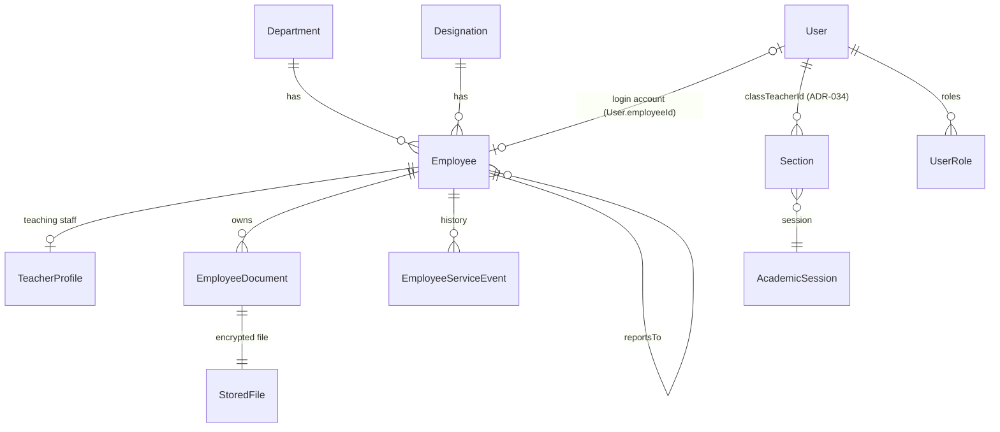

# Phase 3 — HR & Employee Management: assessment and implementation plan

**Status: DECISIONS RECORDED (owner, 2026-11-10) — H1–H14 and Q1–Q3 approved (H13 modified), see §3a; ADR-036. M1 schema/SQL proposal amended 2026-11-11 and **SQL approved 2026-11-18**; migration `20261112000000_phase3a_hr_core` created offline with the schema change and guard test (PHASE_3A_M1_SCHEMA_PROPOSAL.md §12 step 1) and **applied to development and Test 2026-11-18** (steps 2–3). M1 complete; production not migrated. **M2 (master data + employee core) implemented 2026-11-18 on `feat/phase3a-m2-hr-core`** — unit-tested; integration suite written, not run (KI-059, KI-062). **M3a (teacher profiles, account linking — H14, H2) implemented 2026-11-18; M3b (AuthContext employee link, SELF "My profile", class-teacher rule H4, KI-065 link safeguards) owner-approved and implemented 2026-11-18. **M4a (employment changes, reporting line, status/leaving/rejoin, service history — H10–H13) implemented 2026-11-18; M4b (documents & photo) implemented 2026-11-18 after the S-15 decision. **M5 (HR dashboard, directory CSV export) implemented 2026-11-18.**
Phase 2B closure remains a separate, required gate (M0).

---

## 1. Current state (verified from code and docs, read-only)

### 1.1 Phase 2B closure — not formally closed
| Item | State |
|---|---|
| Phase 2B features (S0–S8) | Delivered and verified on the Neon Test branch (PHASE_2B_CLOSURE_REPORT.md) |
| Security audit | Done; 13 findings fixed offline (SECURITY_AUDIT_2026-11-10_PHASE_2B.md §0) |
| **Security integration suite** `tests/integration/security-fixes-2b.test.ts` (S-02, S-03, S-09, S-13, S-14) | **Written, not run** |
| **KI-059** — `TEST_TARGET_BRANCH_ID` / `TEST_TARGET_ENDPOINT_ID` in `.env` | **Unknown** — can't be verified without reading `.env` (not done). Until present, `npm run test:integration` refuses to start (fail closed) |
| Open security decisions | S-07 audit trigger (design), S-15 file purge lifecycle (proposal), S-20 Claude deny-list (diff) |
| Development catalog sync | **Not run** — development lacks `academic.read`, `student.document.manage` and Principal `admission.approve` |
| Git | **Nothing committed** since the Phase 0–1 import — Phase 2a/2/2B and the security fixes exist only in the working tree (KI-005) |
| Roadmap table | Still shows Phase 1 "Blocked" and Phase 2 "Pending" (documentation housekeeping) |

### 1.2 What already exists for HR
- **User ↔ Employee hook:** `User.employeeId String? @unique` (`prisma/schema.prisma:42`) — reserved, **no foreign key yet**, no values anywhere.
- **Class teacher (ADR-034):** `Section.classTeacherId → User` (RESTRICT); eligibility = active, non-deleted user with the TEACHER or CLASS_TEACHER role (`academic.policy.ts` `CLASS_TEACHER_ROLE_KEYS`); partial unique (one class-teacher section per session); access ends when the session closes (S-02) or the teacher role is removed (S-09, `releaseClassTeacherAssignments`).
- **Permissions (catalog):** `employee.read`, `employee.manage`, `employee.sensitive.read`, `leave.request`, `leave.approve`, `attendance.employee.mark`, `attendance.employee.read`, `payroll.*`, `salary.structure.manage`, `salary.self.read` (SELF only), `idcard.generate`, `import.run`, `export.run`.
- **Who holds `employee.read` today (ALL):** Super Admin, School Admin, Principal, Vice Principal (via READ_ACADEMIC), HR Manager, Librarian. `employee.manage`: Super Admin, HR Manager. Teachers hold none.
- **Reusable infrastructure:** `lib/sequence` (row-locked counters), `files.service` + private encrypted storage + upload route pattern (S-01 gate, 120 s deadline), `sharp` photo pipeline, `lib/audit`, Zod `.strict()` schemas, scope policies, `ALLOWED_SCOPES` (S-08), CSV (S-11), roll-number style optimistic `version`.
- **Tenancy:** ADR-002 / ADR-030 — **one school per installation** (separate deployment, database, storage and keys per school). No `schoolId` columns exist.

### 1.3 Dependencies and blockers
| # | Dependency / blocker | Impact on Phase 3 | Proposed handling |
|---|---|---|---|
| B1 | Phase 2B not formally closed | Phase 3 builds on the same files (identity, academic, files) | Close Phase 2B first (§8, M0) |
| B2 | Nothing committed | A Phase 3 mistake can't be cleanly separated from Phase 2B work | **Resolved 2026-11-18:** Phase 2B + M1 committed on branch `phase-2b-and-3a-m1` (`0dbeb78`); M2 code starts on top of it |
| B3 | KI-059 `.env` lines | Phase 3 integration tests can't run | Owner adds two lines |
| B4 | Development catalog not synced | HR screens on development need new permissions too | One owner-approved seed sync for Phase 2B **and** Phase 3 permissions |
| B5 | S-15 retention undecided | Employee documents need the same lifecycle | Decide S-15 before M4 (documents) |
| B6 | Roadmap Phase 3 also lists attendance, leave and payroll | Scope here excludes them | Split: **3A** (this plan) · 3B attendance & leave · 3C payroll (roadmap update) |

---

## 2. Scope

**In (Phase 3A):** employee registration with permanent employee ID; personal and professional profile; contact and address; joining date and employment status; documents and photograph; departments and designations; teacher profiles (qualifications, experience, subject specialisation as text until Phase 4's Subject model); class-teacher integration; non-teaching staff, employment categories, reporting relationships; service history (joining, department/designation changes, internal transfers, resignation, termination, retirement, rejoining); status management; HR dashboard, directory search/filter; linking an employee to an existing login account.

**Out (designed for, not built):** staff attendance, leave, payroll (incl. PAN/bank), staff ID cards, staff import (XLSX/CSV — dependency review), subject-teaching allocations and timetables (Phase 4 TeacherAllocation).

---

## 3. Owner decisions needed (H1–H14)

| # | Decision | Recommendation |
|---|---|---|
| **H1** | **Tenancy.** The request asks for "tenant/school isolation for multi-school readiness"; ADR-002/ADR-030 (owner decision 2026-11-09) fix **one school per installation** — isolation by separate deployment, database, storage and keys. | **Keep ADR-030** — no `schoolId` columns. Multi-school = more installations. Adding `schoolId` now would touch every table and query (Phase 0–2B included) and creates a new class of cross-school leak bugs. If true multi-tenancy is wanted, it needs its own ADR and phase. |
| H2 | Employee ↔ login account | Keep `User.employeeId` (already unique) and **add the FK** → Employee (ON DELETE RESTRICT). One account per employee, optional (not every staff member logs in). No credentials on Employee. Linking/unlinking needs **`employee.manage` + `user.manage`**, is audited, and requires the account to be active and not linked elsewhere |
| H3 | Employee ID format | `EMP-{YYYY}-{SEQ:4}` with `{YYYY}` = **joining year**, from `lib/sequence` (`employee_code:{YYYY}`), assigned at registration, **immutable**; configurable via `SchoolSetting.idFormats.employeeCode` (JSON, no migration) |
| H4 | Class-teacher eligibility | From M3: the user must hold TEACHER/CLASS_TEACHER **and** be linked to an **ACTIVE, TEACHING** employee. Existing assignments stay valid (none exist on development/Test). Employee leaving (resigned/terminated/retired) **releases** class-teacher sections in the same transaction (reuse `releaseClassTeacherAssignments`). `Section.classTeacherId` stays a User reference (ADR-034) — no data migration |
| H5 | Sensitive identifiers | **Do not collect** PAN, bank account, Aadhaar or medical data in 3A (data minimisation, like D6). PAN/bank arrive with payroll (3C), encrypted + HMAC, `employee.sensitive.read` |
| H6 | Personal-data tiers | `employee.read` → **directory** fields (name, code, photo, department, designation, staff type, status, work phone/email, reports-to). New **`employee.personal.read`** → date of birth, personal phone, home address, emergency contact, documents, service-history remarks. Own record via SELF scope |
| H7 | SELF access ("my profile") | Grant `["employee.read","SELF"]` and `["employee.personal.read","SELF"]` to all staff roles; SELF = `Employee.id = ctx.employeeId` (AuthContext gains `employeeId`). Read-only for staff; edits by HR |
| H8 | Documents | New `employee.document.manage` (upload/verify/remove: HR Manager, School Admin); reading needs `employee.personal.read` (or SELF). Purposes `employee.document` (PDF/JPEG/PNG ≤ 10 MB) and `employee.photo` (sharp, EXIF stripped). No identity-document type (no Aadhaar/PAN copies) |
| H9 | Departments & designations | Master data, deactivate (never delete when used), `employee.manage`. Designation has `staffType` (TEACHING / NON_TEACHING); an employee's staff type must match the designation |
| H10 | Reporting relationships | `Employee.reportsToId` (self-FK, RESTRICT); no self-reporting; **no cycles** (checked under row locks); reporting to a leaver refused |
| H11 | Employment categories & status | `appointmentType`: PERMANENT / PROBATION / CONTRACT / PART_TIME / GUEST. `employmentStatus`: ACTIVE / ON_LEAVE (long-term, informational until 3B) / RESIGNED / TERMINATED / RETIRED. Leaving requires a date and a reason; **rejoin** returns to ACTIVE with a new service event (same employee code) |
| H12 | Service history | Append-only `EmployeeServiceEvent` (JOINED, CONFIRMED, DEPARTMENT_CHANGED, DESIGNATION_CHANGED, APPOINTMENT_TYPE_CHANGED, REPORTING_CHANGED, TRANSFERRED (internal), STATUS_CHANGED, RESIGNED, TERMINATED, RETIRED, REJOINED); written by the service in the same transaction as the change; no update/delete path |
| H13 | Leaving employee's login | On leaving, **offer** to deactivate the linked account (checkbox, needs `user.manage`; default on) — via the identity service, never a direct write. Sessions revoked by the existing deactivation path |
| H14 | Teacher subject specialisation | Free-text list now (`specializations text[]`, max 10 × 60); mapped to Phase 4 `Subject` later (no data loss) |

---

## 3a. Approved decisions (owner, 2026-11-10) — binding

| # | Approved decision |
|---|---|
| H1 | **ADR-030 confirmed:** one school per installation. **No `schoolId` columns.** |
| H2 | Existing `User.employeeId` gets a **foreign key** to Employee; account linking is **optional**; linking/unlinking requires **`employee.manage` + `user.manage`** (audited). |
| H3 | Employee ID **`EMP-{YYYY}-{SEQ:4}`**, `{YYYY}` = **joining year**, from the existing `lib/sequence` mechanism; **permanent** (never edited). |
| H4 | Class-teacher assignments require an **ACTIVE, TEACHING** employee linked to the user (in addition to the TEACHER/CLASS_TEACHER role). |
| H5 | **Data minimisation:** no Aadhaar, PAN, bank or medical information in Phase 3A. |
| H6 | Two tiers: **directory** (`employee.read`) and **personal data** (`employee.personal.read`). |
| H7 | **SELF read-only** access to one's own employee profile for **staff roles only** — **never** for Parent or Student roles. |
| H8 | Secure employee documents and photo; management by **HR Manager and School Admin** (`employee.document.manage`). |
| H9 | Department and Designation master data; **deactivate instead of delete**. |
| H10 | Reporting relationships via self-reference with **cycle prevention**. |
| H11 | Employment types, statuses, leaving and rejoining rules **as proposed**. |
| H12 | **Append-only** service history at **application level** (no update/delete service path). **No database trigger** without separate approval under the S-07 decision. |
| H13 | **Modified:** leaving an employee **offers** account deactivation with an **explicit confirmation**; deactivation **requires `user.manage`** and revokes sessions **through the identity service**; if the operator lacks `user.manage`, the leaving is recorded and an **authorized administrator must perform the deactivation** (the screen says so; no silent skip); **audited**. |
| H14 | Free-text teacher specialisation, **max 10 entries × 60 characters**, mapped to Phase 4 subjects later. |
| Q1 | **School Admin gets `employee.manage`.** |
| Q2 | **HR Manager does not get `user.manage`** — account administration stays separate. |
| Q3 | **Librarian keeps `employee.read` at ALL**, restricted to **directory fields only** (H6). |

**Implementation boundaries (owner):** existing RBAC grants are never changed silently (every catalog change is listed for approval); no seed/sync of new permissions without separate approval; no Development/Test/Production database connection; no migration created or applied until approved; authentication and existing student workflows unchanged (M3's AuthContext `employeeId` addition and the class-teacher eligibility rule will be presented for approval before implementation); Phase 2B closure is a separate required gate.

**Catalog changes these decisions imply (for approval at M2 — not made yet):** new `employee.personal.read`; new `employee.document.manage`; `employee.manage` → **+ SCHOOL_ADMIN** (Q1); `employee.document.manage` → HR_MANAGER, SCHOOL_ADMIN (+ Super Admin by construction); `employee.personal.read` ALL → SUPER_ADMIN, SCHOOL_ADMIN, PRINCIPAL, HR_MANAGER; `employee.read` + `employee.personal.read` at **SELF** → staff roles (VICE_PRINCIPAL, ACCOUNTANT, ADMISSION_OFFICER, TEACHER, CLASS_TEACHER, LIBRARIAN, TRANSPORT_MANAGER, and HR/Principal/School Admin already covered by ALL) — **not** PARENT or STUDENT (H7). New grants on existing roles need the owner-approved seed option or the Roles UI (seed adds defaults only for new permissions).

## 4. Database design (Phase 3A)

### 4.1 Models (proposed — one migration `phase3a_hr_core`)
| Model | Fields | Constraints |
|---|---|---|
| **Department** | id, code (VarChar 20), name (VarChar 80), nameKey, isActive, version, createdAt, updatedAt | U(code), U(nameKey); CHECK code format |
| **Designation** | id, code, name, nameKey, staffType (TEACHING/NON_TEACHING), isActive, version, timestamps | U(code), U(nameKey) |
| **Employee** (soft delete) | id, **employeeCode** (immutable), staffType, appointmentType, employmentStatus (default ACTIVE), firstName, middleName?, lastName?, fullName, fullNameNormalized, dob (date), gender, workPhone?, personalPhone, workEmail?, personalEmail?, address JSON?, emergencyContact JSON? (name, relation, phone), departmentId, designationId, reportsToId?, joiningDate (date), confirmationDate?, leavingDate?, leavingReason? (VarChar 500), version, createdById?, timestamps, deletedAt? | U(employeeCode); IX(fullNameNormalized), IX(staffType, employmentStatus), IX(departmentId), IX(reportsToId); CHECK leavingDate ≥ joiningDate; CHECK (status in RESIGNED/TERMINATED/RETIRED) ⇔ leavingDate NOT NULL; CHECK reportsToId ≠ id; CHECK dob ≥ 1940-01-01 and < joiningDate |
| **TeacherProfile** | employeeId (PK, FK RESTRICT), qualifications JSON (degree, subject, institution, year — max 10), professionalQualifications JSON (B.Ed, CTET… — max 10), specializations text[], experienceYearsBefore (smallint 0–60), teacherRegistrationNo?, version, timestamps | 1:1 with a TEACHING employee (service rule) |
| **EmployeeDocument** (soft delete) | id, employeeId, type (PHOTO, RESUME, QUALIFICATION_CERTIFICATE, EXPERIENCE_LETTER, APPOINTMENT_LETTER, RELIEVING_LETTER, OTHER), fileId (U), label?, uploadedById?, verifiedById?, verifiedAt?, createdAt, deletedAt? | partial U(employeeId) WHERE type = PHOTO AND deleted_at IS NULL; IX(employeeId) |
| **EmployeeServiceEvent** (append-only) | id, employeeId, eventType, effectiveDate (date), before JSON?, after JSON?, remarks? (VarChar 500), actedById?, createdAt | IX(employeeId, effectiveDate) |
| **User** (existing) | `employeeId` → **FK** Employee (ON DELETE RESTRICT) | existing U(employeeId) |

Enums: `StaffType`, `AppointmentType`, `EmploymentStatus`, `EmployeeDocumentType`, `ServiceEventType`. Sequences: `employee_code:{YYYY}`. All FKs RESTRICT (people and history are never hard-deleted); dates as `date`, instants `timestamptz(3)`.

### 4.2 Entity relationships

Class-teacher path: `Section.classTeacherId → User → User.employeeId → Employee (ACTIVE, TEACHING)` (H4).

### 4.3 Future-readiness (not built)
`EmployeeAttendance (employeeId, date)` · `LeaveType / LeaveBalance (employeeId, leaveTypeId, academicSessionId) / LeaveRequest` · `SalaryStructure / EmployeeSalary / PayrollRun` + `panEnc`, `bankAccountEnc` on Employee (3C, encrypted) · staff ID cards via `GeneratedDocument` + `idcard.generate`. All key on `Employee.id`; nothing in 3A blocks them.

---

## 5. RBAC

### 5.1 Permission changes (catalog — owner approval, then seed sync)
| Change | Purpose |
|---|---|
| **New `employee.personal.read`** | Personal details, documents, history remarks (H6) |
| **New `employee.document.manage`** | Upload / verify / remove staff documents and photo (H8) |
| `employee.read` + `employee.personal.read` at **SELF** for every staff role | "My profile" (H7); adds SELF to `ALLOWED_SCOPES` for these two |
| No change | `employee.manage` (create/edit/status/departments/designations), `employee.sensitive.read` (reserved for 3C), `user.manage` (account linking, with `employee.manage`) |

### 5.2 Matrix
| Capability | Super Admin | School Admin | Principal | Vice Principal | HR Manager | Accountant | Admission Officer | Teacher / Class Teacher | Librarian | Transport Mgr | Parent / Student |
|---|---|---|---|---|---|---|---|---|---|---|---|
| Staff directory (`employee.read`) | ALL | ALL | ALL | ALL | ALL | — | — | — | ALL (existing) | — | — |
| Own profile (`employee.read` SELF) | ✓ | ✓ | ✓ | ✓ | ✓ | SELF | SELF | SELF | SELF | SELF | — |
| Personal details & documents (`employee.personal.read`) | ALL | ALL | ALL | — | ALL | SELF | SELF | SELF | SELF | SELF | — |
| Create / edit / status / departments / designations (`employee.manage`) | ✓ | — (owner: grant?) | — | — | ✓ | — | — | — | — | — | — |
| Documents & photo (`employee.document.manage`) | ✓ | ✓ | — | — | ✓ | — | — | — | — | — | — |
| Link / unlink login account (`employee.manage` + `user.manage`) | ✓ | — | — | — | — (no `user.manage`) | — | — | — | — | — | — |
| Assign class teacher (`academic.manage`, existing) | ✓ | ✓ | — | — | — | — | — | — | — | — | — |
| PAN / bank (`employee.sensitive.read`) | reserved for payroll (3C) — not collected in 3A | | | | | | | | | | |

Open matrix questions: should **School Admin** hold `employee.manage` (today only HR Manager and Super Admin)? Should **HR Manager** link accounts (needs `user.manage`, which School Admin holds but HR Manager doesn't)? Should **Librarian** keep `employee.read` ALL (existing grant; directory fields only after H6)?

### 5.3 Policies (pure, unit-tested — `hr.policy.ts`)
- `employeeScopeWhere(scope, ctx)`: ALL → all non-deleted; SELF → `{ id: ctx.employeeId }` (none if unlinked); ASSIGNED/CHILDREN refused.
- Field tiers: directory select vs personal select chosen by the caller's `employee.personal.read` scope; SELF personal read only for the own record.
- Delegation: account linking reuses `assertCanModifyUser` (no linking a more-privileged account); an HR user can't change their own employment status or reporting line (approver ≠ subject) — enforced via the account link (`AuthContext.employeeId`); unlinked administrators: KI-069.

---

## 6. Service / API architecture

```
src/modules/hr/
  hr.schemas.ts          Zod .strict(): department, designation, employee create/update (per section),
                         teacher profile, status change, reporting change, account link, list filters
  hr.rules.ts            pure: status machine, leaving rules, staff-type ↔ designation, reporting-cycle
                         detection, code planning (D-H3), field allowances, name normalisation (reuse person-fields)
  hr.policy.ts           pure: scopes, field tiers, approver ≠ subject
  departments.service.ts / designations.service.ts      master data (version, deactivate)
  employees.service.ts   register (code + JOINED event, one tx), update (field-level, version), changeStatus
                         (event + optional account deactivation via identity + class-teacher release),
                         changeReporting (cycle check under locks), list/search/get (tiers), dashboard counts
  teacher-profiles.service.ts
  employee-documents.service.ts   upload/replace/verify/remove (files.service; one current photo)
  hr.tx.ts               tx helpers for other modules: assertEligibleClassTeacher(tx, userId)  (H4)
src/app/api/v1/employees/[id]/documents/route.ts          POST upload (S-01 gate, 120 s deadline, same-origin)
src/app/api/v1/employees/[id]/documents/[docId]/route.ts  GET download (scope, owner-bound, 404 no-oracle)
src/app/api/v1/employees/[id]/photo/route.ts              GET photo (employee.read scope)
src/app/erp/hr/**  pages + server actions (≤ 30 lines each)
```
Cross-module calls (service → service / tx helper only): `academic.sections.assignClassTeacher` → `hr.tx.assertEligibleClassTeacher`; `hr.employees.changeStatus` → `academic.tx.releaseClassTeacherAssignments` and `identity.users.setUserActive`. Lock order for leaving: employee FOR UPDATE → (identity: Super Admin guard, user) → sections FOR UPDATE — documented and tested; no reverse order elsewhere.

Every write: `authorize` → policy → one short transaction (`lock_timeout` 5 s, D11) → audit (ids, field names; **no personal values** for personal-tier fields — "[REDACTED]" like Phase 2B sensitive handling) → `ServiceBusyError` on contention.

---

## 7. UI pages (mobile-first, existing design system)

| Route | Content | Permission |
|---|---|---|
| `/erp/hr` | HR dashboard: counts by staff type / status / department, recent joiners & leavers, employees without a login, teaching staff without a class-teacher section (current session) | `employee.read` ALL |
| `/erp/hr/employees` | Directory: search (name, employee ID, phone), filters (staff type, department, designation, status, appointment type), table ≥ md / cards < md | `employee.read` ALL |
| `/erp/hr/employees/new` | Multi-step registration: personal → contact & emergency → employment (department, designation, type, joining date, reports-to) → teacher profile (teaching only) → review; employee ID shown after save | `employee.manage` |
| `/erp/hr/employees/[id]` | Profile sections: overview, employment & reporting, teacher profile & class-teacher sections, documents, service history, login account | `employee.read` (+ tiers) |
| `/erp/hr/employees/[id]/edit` | Field-level edit by section | `employee.manage` |
| `/erp/hr/employees/[id]/status` | Resign / terminate / retire / rejoin (date, reason; offer to deactivate login; shows class-teacher sections that will be released) | `employee.manage` |
| `/erp/hr/departments`, `/erp/hr/designations` | Master data lists, add, edit, deactivate | `employee.manage` |
| `/erp/account` → "My profile" | Own employee record (read-only) | `employee.read` SELF |
| Users → user page | "Linked employee" panel (link/unlink) | `employee.manage` + `user.manage` |
Nav: "Staff" (ALL readers). Class-teacher picker on Sections lists only eligible teachers (H4).

---

## 8. Implementation sequence and milestones

| Milestone | Content | Gate |
|---|---|---|
| **M0 — Phase 2B close-out** | Owner decisions on the closure report; KI-059 `.env` lines; run the security integration suite on Test; commit Phase 2B on a branch; decide S-07/S-15/S-20 | Owner approvals (Test run, commit) |
| **M1 — HR core schema** | Decisions H1–H14; Prisma models (§4) + `--create-only` migration `phase3a_hr_core` + static migration guard test; review SQL | **Owner approval of the SQL**, then apply to development, then Test (separate approvals) |
| **M2 — Master data + employee core** | Departments, designations, employee registration (code + JOINED event), directory, profile, field-level edit, catalog changes (§5.1) + seed sync (approval) | Unit + integration green on Test |
| **M3 — Teachers & accounts** | Teacher profiles, account linking (H2), class-teacher eligibility (H4), "My profile" (SELF) | Integration incl. RBAC 403 matrix |
| **M4 — Documents, history, status** | Documents/photo (upload route, owner-bound downloads), service history timeline, status changes (leaving releases class-teacher sections, optional account deactivation), reporting relationships (cycle-safe) | Upload security tests; concurrency tests |
| **M5 — HR dashboard & polish** | Dashboard, search/filter, optional CSV export of the directory (export.run + ALL; S-11 CSV rules) | — |
| **M6 — Verification & close** | Full integration on Test, browser review (roles × 360/768/1280), security-auditor review, docs, closure report | Owner sign-off |

Estimated effort (working sessions of the size used for Phase 2B slices): M1 ≈ 1, M2 ≈ 2, M3 ≈ 1–2, M4 ≈ 2, M5 ≈ 1, M6 ≈ 1–2 — about **8–10 sessions**, excluding approval waits.

**Proposed first milestone: M0 + M1.** Close out Phase 2B (approvals listed), then — after H1–H14 are decided — write the Phase 3A Prisma models and a **create-only** migration for SQL review. No database writes until the SQL is approved.

---

## 9. Validation and security requirements

- Zod `.strict()` on every input; names via the shared `person.schemas` (NAME_RE, NFC), Indian phone normalisation, email, dates (dob 1940+, before joining; joining ≤ today + 90 days; leaving ≥ joining and ≤ today), reason 3–500 chars, JSON sub-schemas bounded (≤ 10 qualifications, ≤ 10 specialisations).
- Employee code from `lib/sequence` only, inside the registration transaction; immutable (not in any update schema); unique-violation backstop mapped to a clear error.
- Every service: `authorize` + scope policy + explicit `select` per tier; missing and out-of-scope look identical (404).
- Optimistic `version` on Employee, TeacherProfile, Department, Designation; row locks for status/reporting changes; `lock_timeout` 5 s.
- Audit in the same transaction for: create, every field change (field names; personal-tier values redacted), status changes, reporting changes, account link/unlink, document upload/replace/verify/remove/download, department/designation changes, class-teacher releases.
- Private files only via `lib/storage` (encrypted, magic bytes, sharp for photos, owner-bound reads, PDF sandboxed); upload route with the S-01 gate and deadline; same-origin + rate limit.
- No personal data in logs, errors, exports (unless permitted), notifications or the chatbot. No real staff data in seeds/tests.
- 360 px first; table/cards; 44 px targets; accessible forms.

## 10. Test plan

- **Unit:** schemas (every form section, `.strict()`, IDs refused); rules (status machine incl. rejoin, leaving dates, staff type ↔ designation, reporting-cycle detection on chains/self, code format/keys); policies (ALL/SELF/none, field tiers, approver ≠ subject); catalog (new permissions, `ALLOWED_SCOPES`, matrix); upload route (gate before body, deadline, owner-bound download, 404 no-oracle); CSV if export ships.
- **Integration (Test branch, behind the S-05 guard):** registration → unique sequential codes under concurrency (e.g. 20 parallel); JOINED event + audit in one transaction; field-level edits + version conflicts; account link (one-to-one, `assertCanModifyUser`, refused for inactive/linked accounts); class-teacher eligibility (unlinked / non-teaching / leaver refused); leaving releases class-teacher sections and (optionally) deactivates the account, all-or-nothing; rejoin; reporting cycles refused under concurrent changes; documents (photo replace, owner binding, retire); SELF access (own profile only); RBAC 403 for every role without permission; no personal values in audit rows.
- **E2E / browser (later, M6):** HR Manager registers a teacher on a phone, links the account, assigns class teacher; staff member sees "My profile"; Librarian sees directory fields only; leaver flow.

## 11. Migration and rollback strategy

- One additive migration `phase3a_hr_core` (new enums + 6 tables + one FK on `user.employee_id`); no changes to existing columns or data. Created with `--create-only`, SQL reviewed (DROP/DELETE only in rollback comments), static guard test, **owner approval**, applied to **development** then **Test** (identity checks, drift 0, `db:check`), never production without approval.
- **Pre-check:** `user.employee_id` has no values on development/Test (adding the FK would fail otherwise — verified read-only before applying).
- **Rollback (comment block in the migration):** drop the FK on `user.employee_id`, drop the 6 tables (child first), drop the enums, delete the `_prisma_migrations` row — only on development/Test and only while they hold no real data; Neon branch restore point taken before applying.
- **Backward compatibility:** the previous release ignores the new tables; `User.employeeId` stays nullable.
- **Seed:** new permissions + SELF grants via the guarded seed (new permissions get their defaults on existing roles automatically; SELF grants on **existing** roles need the owner-approved seed option or the Roles UI — same situation as Principal `admission.approve` in Phase 2B).

## 12. Risk assessment

| # | Risk | Likelihood / impact | Mitigation |
|---|---|---|---|
| R1 | Staff personal data over-exposed (Librarian/Principal directory access, audit payloads) | M / H | H6 tiers; explicit selects; redacted audit values; tests per role |
| R2 | Linking the wrong account to an employee (or an attacker's account to an HR employee) | L / H | Two permissions, `assertCanModifyUser`, one-to-one unique, audit, no auto-linking by email |
| R3 | Class-teacher eligibility change breaks assignments | L / M | No assignments exist on development/Test; rule applies to new assignments; leavers released explicitly |
| R4 | Module dependency loop (academic ↔ hr ↔ identity) | M / M | Only tx-helper / service calls; `check:deps` must stay clean; documented lock order |
| R5 | Reporting-line cycles under concurrency | L / M | Lock the chain in id order; cycle check under lock; tests |
| R6 | Phase 2B open items carried into Phase 3 (uncommitted work, untested security fixes, unsynced catalog) | H / H | M0 before code |
| R7 | Document retention (DPDP) | M / M | S-15 decision before M4; no identity-document types |
| R8 | Scope creep into attendance/leave/payroll | M / M | 3A/3B/3C split; future-readiness only |
| R9 | Neon Free limits (storage, compute) | L / M | Files in private storage, not the database; paginated queries; indexes on search columns |
| R10 | Multi-school expectation vs ADR-030 | M / H | H1 decision recorded as an ADR before M1 |

## 13. Documentation to update during Phase 3
ADR-036 (Phase 3A HR model, H1–H14), DATABASE_SCHEMA §5 / DATABASE_RELATIONSHIPS, RBAC_MATRIX + AUTHENTICATION_AND_RBAC, API_DOCUMENTATION, SECURITY, DEVELOPMENT_ROADMAP (3A/3B/3C split), KNOWN_ISSUES, DEVELOPMENT_PROGRESS, CHANGELOG. (Note: the progress log is `docs/DEVELOPMENT_PROGRESS.md`; there is no `docs/PROGRESS.md`.)
